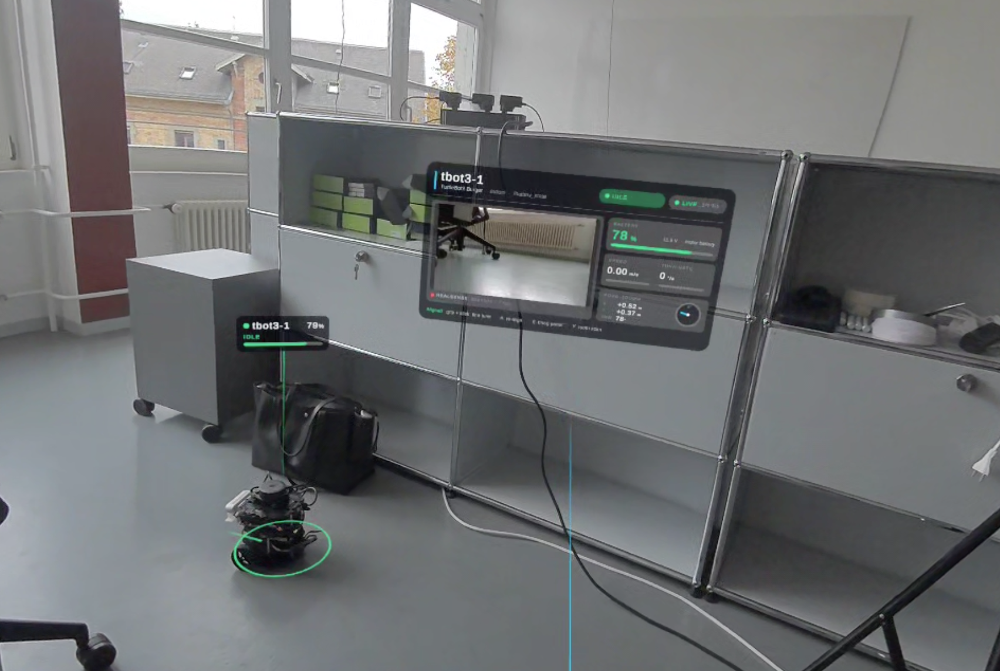

# TurtleBot3 Mixed-Reality Inspection Supervisor

Live telemetry, a camera view and inspection points from a real TurtleBot3, shown where the robot actually is in the room through a Meta Quest 3S.



The project has two halves that talk over ROS 2:

- **Headset (Unity, Meta Quest):** a passthrough MR app. A tag with ID, status and battery floats above the real robot, a glowing ring marks its footprint, and a panel shows speed, turn rate, pose, battery and the robot's live camera. With SLAM running, the live map is drawn on the real floor and the robot can be sent anywhere by pointing the controller at the floor.
- **Robot (ROS 2 Jazzy):** the TurtleBot3 publishes odometry, lidar, battery and RealSense images. A C++ package adds SLAM mapping, Nav2 navigation and visual "inspection points": printed ArUco markers that the robot finds with its camera and places on the map.

## How it fits together

```
 TurtleBot3 (Raspberry Pi 4, ROS 2 Jazzy)                    Meta Quest 3S
 ┌──────────────────────────────────────┐   Wi-Fi, TCP      ┌──────────────────────────┐
 │ turtlebot3_bringup  /odom /scan      │   port 10000      │ Unity app (passthrough)  │
 │                     /battery_state   │ ◀─────────────▶   │ head tag · floor ring    │
 │ realsense2_camera   compressed image │  telemetry, map,  │ telemetry panel + camera │
 │ ros_tcp_endpoint    bridge to Unity  │  path ▶ ◀ goals   │ SLAM map · point-and-go  │
 └──────────────────────────────────────┘                   └──────────────────────────┘
          ▲ DDS over Wi-Fi: /scan /odom /tf ▶   ◀ /cmd_vel /map /plan
          ▼
 ROS 2 PC on the robot's network (live)       or   development PC (rosbag replay)
 tb3_mr_inspection: scan_resampler · slam_toolbox · Nav2 · mr_frames_publisher · aruco_inspector
```

## Methods

**Placing the robot in the room.** The robot only knows its pose in its own odometry frame, and the headset only knows its own world frame. The operator rests the right controller on the robot and presses A; the app records both poses at that instant and computes the transform between the frames. From then on every odometry message (about 20 Hz) is mapped through that transform, so the tag and ring follow the real robot. ROS axes (x forward, y left, z up) are converted to Unity's (x right, y up, z forward). Small offsets can be corrected with the grip buttons and thumbsticks.

**Telemetry.** Unity subscribes to `/odom`, `/battery_state` and the compressed RealSense image through ROS-TCP-Connector. A status (moving, idle, low battery, charging, no data, no link) is derived from speed, battery and message age. Camera frames arrive as JPEG and only the newest one is decoded each frame, so the view never lags behind.

**Mapping.** The TurtleBot3's LDS-02 lidar returns a different number of beams on every turn (about 218 to 244), which slam_toolbox rejects. `scan_resampler` (C++) resamples every scan onto a fixed 360 × 1° grid before slam_toolbox builds the map.

**Drift-free tracking and point-and-go.** Odometry drifts as the wheels slip. slam_toolbox corrects that by moving the odometry frame inside the map; `mr_frames_publisher` sends just this correction (map → odom) to the headset, which then places the robot by map pose instead of raw odometry. The same alignment draws the occupancy grid on the floor and turns a point the operator aims at into a Nav2 goal in the map frame; Nav2's planned path is drawn back on the floor. On Jazzy, Nav2 publishes plain `Twist` by default while the TurtleBot3 accepts only `TwistStamped`, so the Nav2 parameters enable stamped velocity on every node that outputs `cmd_vel`.

**Inspection points.** `aruco_inspector` (C++, OpenCV) finds ArUco markers in the colour stream, refines their corners to sub-pixel accuracy, and estimates each marker's pose with a square-target PnP using the camera's calibration and the printed marker size. TF moves the pose into the map frame; a point is confirmed after three sightings and smoothed over time.

## Hardware and software

| Part | Used |
| --- | --- |
| Robot | TurtleBot3 Burger: OpenCR, LDS-02 lidar, Raspberry Pi 4 |
| Camera | Intel RealSense D435i (colour, 424 × 240, compressed) |
| Headset | Meta Quest 3S, passthrough mixed reality |
| Robot software | ROS 2 Jazzy, Ubuntu 24.04 |
| Unity | 2022.3.62f2, Meta XR SDK 201, MR Utility Kit, ROS-TCP-Connector 0.6 |
| Development | ROS 2 Jazzy in Docker, slam_toolbox, OpenCV 4.6, RViz2 |

## Results

- **Live MR telemetry on a real robot:** after a one-press alignment the tag and ring follow the TurtleBot3 as it drives; odometry arrives at about 20 Hz and the panel shows battery, motion, pose and the live camera image in the headset.
- **Scan resampler:** 7/7 unit tests (beam count, wrap-around, start angle, coverage gaps, intensities, invalid input).
- **Marker pose accuracy** on synthetic 424 × 240 frames with a 10 cm marker:

| Distance | Without refinement | Sub-pixel refinement |
| --- | --- | --- |
| 0.6 m | 10 mm | 7 mm |
| 1.2 m | 71 mm | 27 mm |
| 2.0 m | 179 mm | 91 mm |

- **End to end** (simulated robot stream, 15 cm marker at 1.0 m, through slam_toolbox and TF): point confirmed in the map frame 3.5 mm from ground truth.
- **Live mapping and point-and-go on the real robot:** the Burger mapped the room with slam_toolbox while driven by teleop; in the headset the occupancy grid lined up with the real floor, and goals sent by aiming the controller at the floor and clicking the stick were planned and driven by Nav2, with the planned path drawn on the floor.
- **Mapping + Nav2** on a simulated Burger (before the real test): map built, all Nav2 servers active, a goal on `/goal_pose` reached and reported as succeeded.

## Repository structure

```
turtlebot-mr-inspection/
├── unity/RealTurtleBotMR/          Unity folder: copy into the host project's Assets/
│   ├── Scenes/RealTurtleBotMR.unity
│   ├── Scripts/ROS/                TurtleBotTelemetry, RobotCameraFeed, EditorQuickTest
│   ├── Scripts/Calibration/        RobotWorldAnchor (controller alignment)
│   ├── Scripts/Dashboard/          RobotHeadTag, RobotFootprint, TelemetryPanel, MRStyle
│   ├── Scripts/MR/                 RoomMeshVisibility
│   ├── Scripts/Navigation/         MapOverlay (SLAM map on the floor), NavGoalSender (point-and-go)
│   └── Editor/                     "RealTurtleBotMR > Set Up Scene" tool
├── ros2/tb3_mr_inspection/         ROS 2 package (C++): SLAM + inspection points
│   ├── src/                        scan_resampler, aruco_inspector, mr_frames_publisher
│   ├── include/ test/              resampling logic + GoogleTest
│   ├── launch/                     mapping_nav (live SLAM + Nav2), inspection (replay)
│   ├── config/ rviz/               slam_toolbox, Nav2 (Burger, Jazzy), inspector
│   └── markers/                    printable ArUco markers (15 cm)
├── tools/
│   ├── patch_unity_project_for_quest.py   makes the host project build for Quest
│   └── sync_unity.sh                      copies the Unity folder into this repo, sanitised
└── docs/images/
```

## Reproduce

Placeholders: `<ROBOT_IP>` is your TurtleBot's address on your Wi-Fi, `<ROBOT_USER>` its login. Robot, headset and computers must be on the same local network.

### 1. Robot

Each command in its own SSH terminal on the robot (`ssh <ROBOT_USER>@<ROBOT_IP>`), with the TurtleBot3 ROS 2 Jazzy setup installed:

```bash
ros2 launch turtlebot3_bringup robot.launch.py
ros2 launch realsense2_camera rs_launch.py enable_depth:=false pointcloud.enable:=false rgb_camera.color_profile:=424x240x15
```

Bridge to Unity, built once on the robot:

```bash
mkdir -p ~/mr_ws/src && cd ~/mr_ws/src
git clone -b main-ros2 https://github.com/Unity-Technologies/ROS-TCP-Endpoint.git
cd ~/mr_ws && colcon build
source ~/mr_ws/install/setup.bash
ros2 run ros_tcp_endpoint default_server_endpoint --ros-args -p ROS_IP:=0.0.0.0
```

Drive with `ros2 run turtlebot3_teleop teleop_keyboard`.

### 2. Headset app

1. Clone the host project [MR-SLAM](https://github.com/prakash-aryan/MR-SLAM) and open it once in Unity 2022.3.62f2 (Android Build Support installed). Close Unity.
2. Copy `unity/RealTurtleBotMR` and `unity/RealTurtleBotMR.meta` into the project's `Assets/`.
3. Make it build for Quest: `python3 tools/patch_unity_project_for_quest.py /path/to/MR-SLAM`
4. Open Unity, run **RealTurtleBotMR → Set Up Scene**, switch the platform to Android and **Build And Run** to the Quest (developer mode on, USB-C).
5. In the headset (controllers, not hands): type the IP of the machine running the bridge in the ROS panel (`<ROBOT_IP>` if it runs on the robot) and press **Connect**. Rest the right controller on the robot, pointing where it drives, and press **A**.

| Control | Action |
| --- | --- |
| A | Align with the robot |
| Right grip + right stick / left grip + left stick | Slide / rotate the alignment |
| B | Bring the panel in front of you |
| Right stick pressed down (aiming at the floor, white ring visible) | Send the robot there (needs SLAM + Nav2) |
| X | Show or hide the SLAM map on the floor |
| Y | Show or hide the room scan |
| Trigger | Click UI |

### 3. Live mapping and point-and-go

On a ROS 2 Jazzy machine on the robot's network, with the robot running bringup and the bridge:

```bash
sudo apt install ros-jazzy-slam-toolbox ros-jazzy-navigation2 ros-jazzy-nav2-bringup libopencv-dev
cd ~/ws/src && git clone <this repo>
cd ~/ws && colcon build --packages-select tb3_mr_inspection && source install/setup.bash
ros2 launch tb3_mr_inspection mapping_nav.launch.py
```

Wait for `Managed nodes are active`, drive with teleop to build the map, stop teleop, then send goals with **Nav2 Goal** in RViz, or in the headset: align with A, aim at the floor until the white ring appears and press the right stick down.

Tested setup: the robot runs only bringup (and the camera); SLAM, Nav2 and the Unity bridge run on the computer (`ros2 run ros_tcp_endpoint default_server_endpoint --ros-args -p ROS_IP:=0.0.0.0`), and the headset connects to the computer's IP. With the headset on, `rviz:=false` saves memory on a small VM.

### 4. Inspection points (recorded session)

Run the unit tests: `colcon test --packages-select tb3_mr_inspection && colcon test-result --verbose`.

Print `ros2/tb3_mr_inspection/markers/` at 100 % and tape the markers at the camera's height. Record a drive on the robot:

```bash
ros2 bag record -o ~/bags/session_01 /scan /odom /tf /tf_static /imu /joint_states /battery_state \
  /camera/camera/color/image_raw/compressed /camera/camera/color/camera_info
```

Replay it on the development machine:

```bash
ros2 launch tb3_mr_inspection inspection.launch.py
ros2 bag play ~/bags/session_01 --clock
```

Live instead of replay: `ros2 launch tb3_mr_inspection inspection.launch.py use_sim_time:=false`.

## Built on

This project started from these repositories. Their code is not copied here; it is used as dependencies or as the host project.

| Project | Used for | What changed |
| --- | --- | --- |
| [MR-SLAM](https://github.com/prakash-aryan/MR-SLAM) by Prakash Aryan ([paper](https://arxiv.org/abs/2605.16432)), my supervisor | Host Unity project: Quest passthrough rig, ROS connection, in-headset IP panel, laser-pointer interaction | New single-robot scene derived from its MR scene: the three simulated robots and the multi-robot dashboard were replaced by the real-robot tag, ring, telemetry panel, camera feed and alignment |
| [ROS-TCP-Connector / ROS-TCP-Endpoint](https://github.com/Unity-Technologies/ROS-TCP-Connector) (Unity Technologies) | ROS 2 ↔ Unity messaging | Runtime assemblies enabled for Android (`tools/patch_unity_project_for_quest.py`) |
| [URDF-Importer](https://github.com/Unity-Technologies/URDF-Importer) (Unity Technologies) | Dependency of the host project | Desktop-only native plugins excluded from Android builds |
| [Meta XR SDK and MR Utility Kit](https://developers.meta.com/horizon/documentation/unity/) | Passthrough, scene understanding, controller input | Passthrough and scene support enabled |
| [TurtleBot3](https://github.com/ROBOTIS-GIT/turtlebot3) (ROBOTIS) | Robot bringup and teleoperation | — |
| [slam_toolbox](https://github.com/SteveMacenski/slam_toolbox) | 2D mapping | Parameters tuned for the LDS-02 and a small room |
| [Nav2](https://github.com/ros-navigation/navigation2) | Path planning and control | Jazzy default parameters adapted for the Burger (stamped `cmd_vel`, footprint, speeds) |
| [realsense-ros](https://github.com/IntelRealSense/realsense-ros) (Intel) | Camera driver | — |
| [OpenCV](https://opencv.org) ArUco | Marker detection and pose | — |

## License

Code in this repository: Apache-2.0 (see `LICENSE`). The scene is derived from MR-SLAM (MIT); see `THIRD_PARTY_NOTICES.md`.
